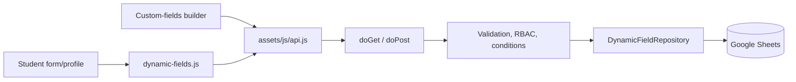

# Dynamic Custom Fields

> แนวทางกลางสำหรับการขยายชีต คอลัมน์ ฟิลด์ และการย้ายข้อมูลในอนาคตอยู่ที่ `SAFE_SCHEMA_EVOLUTION.md` และให้ถือเป็นข้อกำหนดบังคับร่วมกับเอกสารนี้

## การวิเคราะห์ระบบเดิม

Frontend เป็น GitHub Pages แบบ HTML/Vanilla JavaScript และเรียก Google Apps Script Web App ผ่าน `fetch` ใน `assets/js/api.js` ส่วน backend ใช้ `doGet`/`doPost` ใน `Code.gs` และเก็บข้อมูลหลักใน Google Sheets ตาราง `Students` โดยใช้ `StipNo` เป็นรหัสอ้างอิงนักเรียน

จุดที่เกี่ยวข้องกับความสามารถนี้คือ:

- `student-form.html` แสดงและบันทึกข้อมูลนักเรียน
- `student-profile.html` แสดงข้อมูลสำหรับอ่านและพิมพ์
- `settings.html` และ `assets/js/rbac.js` จัดการสิทธิ์
- `assets/js/i18n.js` จัดการภาษาไทยและอังกฤษ
- `Code.gs` ทำ routing, authentication, service และ repository
- `databasesetup.gs` ตรวจและติดตั้งโครงสร้างชีต

ระบบเดิมยังคงใช้คอลัมน์คงที่ใน `Students` ตามเดิม ความสามารถใหม่ไม่เพิ่ม ลบ หรือเปลี่ยนชื่อคอลัมน์ในชีตนี้

## สถาปัตยกรรมที่ใช้

การไหลของข้อมูลเป็นดังนี้:



ข้อมูลหลักและ metadata แยกจากกันอย่างชัดเจน:

| Sheet | หน้าที่ |
| --- | --- |
| `FormSections` | ส่วนของแบบฟอร์ม ชื่อสองภาษา ลำดับ เงื่อนไข สิทธิ์ และรูปแบบ single/repeatable |
| `CustomFieldDefinitions` | นิยามฟิลด์ ชนิด validation สิทธิ์ และสถานะ archive |
| `CustomFieldOptions` | ตัวเลือกของ select, multiselect และ radio พร้อมป้ายสองภาษา |
| `CustomFieldValues` | ค่าของ entity โดยอ้างอิง `EntityID`, `FieldID`, `RecordID` และสถานะ Active |
| `CustomFieldAuditLog` | ประวัติผู้ใช้ บทบาท การกระทำ ค่าเดิม ค่าใหม่ และผลลัพธ์ |
| `EmploymentFollowUps` | เหตุการณ์ติดตามศิษย์เก่า โดยอ้าง `StipNo` และ `EmploymentRecordID` ไม่คัดลอกข้อมูลบุคคลหรืองาน |
| `EmploymentMigrationLog` | หลักฐานการย้ายข้อมูลเดิมต่อ source key เพื่อให้ migration ทำซ้ำได้โดยไม่สร้างรายการซ้ำ |

สองชีตสุดท้ายเป็นโครงสร้างปฏิบัติการเฉพาะแม่แบบภาวะการทำงาน ไม่ถูกรวมเป็นเงื่อนไขความพร้อมของ custom fields พื้นฐาน ดังนั้นฟอร์มเดิมและช่องข้อมูลเพิ่มเติมที่มีอยู่จะยังทำงานได้แม้ยังไม่ได้เปิดใช้ระบบติดตามศิษย์เก่า

`FieldID`, `SectionID`, `OptionID`, `ValueID` และ `RecordID` เป็นรหัสคงที่ ระบบสุ่ม `FieldKey` และ `SectionKey` ที่ไม่ซ้ำให้อัตโนมัติเมื่อสร้างรายการ และล็อกไม่ให้เปลี่ยนหลังบันทึกเพื่อไม่ให้ข้อมูลเดิมเสียความสัมพันธ์ การแก้ชื่อไทยหรืออังกฤษไม่มีผลต่อคีย์เหล่านี้

## ความปลอดภัยและความเข้ากันได้

- Backend ตรวจ session และ permission ทุก endpoint ของ custom fields
- `manageCustomFields` ควบคุมการสร้าง แก้ไข จัดลำดับ setup และ archive
- การอ่านและบันทึกค่าตรวจสิทธิ์ของ entity, section, field และ role ซ้ำที่ backend
- Student อ่านและแก้ไขได้เฉพาะ `StipNo` ของตนเอง ส่วนข้อมูลหลักของ Student ถูกกรองด้วย allowlist ฝั่ง server
- ค่าใหม่ผ่าน type validation, length/range, option allowlist, safe regular expression, unique validation และ formula-injection protection
- UI สร้างข้อความ metadata ด้วย DOM `textContent` เพื่อป้องกัน HTML injection
- การเขียนใช้ `LockService`, batch write, schema cache และ audit log
- การ archive ไม่ลบ definition หรือ values เดิม การลบ repeatable record เปลี่ยนค่าเป็น inactive และบันทึก audit
- หากยังไม่ติดตั้ง schema หรือยังไม่มี section หน้าฟอร์มและโปรไฟล์เดิมยังทำงานได้ตามปกติ

## Setup และ rollback

หน้า `custom-fields.html` แสดง dry-run จาก `previewDynamicFieldSetup()` ก่อน setup ผู้ใช้จะเห็นชีตที่ขาด หัวคอลัมน์ที่ขาด และจำนวนแถวเดิม

`setupDynamicFieldSheets()` ทำเฉพาะสองอย่าง:

1. สร้างชีตที่ยังไม่มี
2. เพิ่มหัวคอลัมน์ที่ขาดต่อท้ายชีตเดิม

ฟังก์ชันนี้ไม่เรียก `clear()`, `deleteRow()`, `deleteColumn()` หรือ `deleteSheet()` การ rollback ของฟิลด์ให้ใช้ archive ส่วน rollback ของ feature ทำได้โดยนำ script `dynamic-fields.js` และ container ออกจากหน้าเดิม โดยข้อมูลหลักใน `Students` ไม่ได้รับผลกระทบ

## การเพิ่มฟิลด์ผ่านหน้าจอ

ผู้มีสิทธิ์ `manageCustomFields` เปิดตัวจัดรูปแบบได้จากปุ่ม **จัดรูปแบบส่วนข้อมูล** ที่หน้ารายชื่อนักเรียนหรือหน้าเพิ่ม/แก้ไขนักเรียน ส่วนเครื่องมือฉบับเต็มอยู่ที่ **ตั้งค่าระบบ → ช่องข้อมูลเพิ่มเติม** และไม่มีเมนูซ้ำบน Dashboard

1. เปิด **ตั้งค่าระบบ → ช่องข้อมูลเพิ่มเติม** หรือใช้ปุ่มลัดจากเมนูนักเรียน
2. ตรวจสถานะ schema และติดตั้งส่วนที่ขาดเมื่อระบบแจ้ง
3. สร้าง section พร้อมชื่อไทย/อังกฤษ สิทธิ์ และ cardinality แล้วเลือกกลุ่มเป้าหมายแบบ **นักเรียนทุกคน**, **เฉพาะศิษย์เก่า** หรือ **กำหนดเงื่อนไขเอง**
4. สร้าง field เลือกชนิด validation ตัวเลือก สิทธิ์ และเงื่อนไข
5. เปิดฟอร์มหรือโปรไฟล์นักเรียนเพื่อตรวจผล

หลังบันทึก section ให้กดปุ่ม `+` ที่ section นั้นเพื่อเพิ่ม field ทีละรายการ รูปแบบข้อมูลทั้งหมดกำหนดในช่อง **ชนิดฟิลด์** ของหน้าเดียวกัน ค่าจริงจะถูกกรอกภายหลังจากหน้าเพิ่ม/แก้ไขนักเรียนในส่วนข้อมูลที่ระบบสร้างให้

ตัวอย่าง section **ประวัติการทำงาน** แบบ `repeatable` ควรสร้าง field ตามลำดับนี้:

| ข้อมูล | ชนิดฟิลด์ |
| --- | --- |
| ชื่อสถานที่ทำงาน/นายจ้าง | ข้อความบรรทัดเดียว (`text`) |
| ที่ตั้งสถานที่ทำงาน | ข้อความบรรทัดเดียว (`text`) |
| จังหวัด/ประเทศที่ทำงาน | ข้อความบรรทัดเดียว (`text`) |
| ตำแหน่งงาน | ข้อความบรรทัดเดียว (`text`) |
| รูปแบบการจ้างงาน | รายการตัวเลือก (`select`) |
| ประเภทธุรกิจ/อุตสาหกรรม | ข้อความบรรทัดเดียว (`text`) |
| เดือนเริ่มงาน | เดือนและปี (`month`) |
| เดือนสิ้นสุดงาน | เดือนและปี (`month`) |
| ระยะเวลาทำงาน | ระยะเวลาคำนวณอัตโนมัติ (`calculated_duration`) |
| รายละเอียดเพิ่มเติม | ข้อความหลายบรรทัด (`textarea`) |
| สถานะการตรวจสอบ | รายการตัวเลือก (`select`) |

เมื่อเลือกชนิด `calculated_duration` หน้า builder จะแสดงรายการให้เลือกฟิลด์เดือนเริ่มต้นและเดือนสิ้นสุดจาก section เดียวกัน จึงต้องสร้าง field ต้นทางสองรายการก่อน ผลลัพธ์นับรวมเดือนเริ่มต้นและเดือนสิ้นสุด เช่น มกราคม–ธันวาคมเท่ากับ 1 ปี และเลือกคำนวณถึงเดือนปัจจุบันได้เมื่อยังไม่ได้ระบุเดือนสิ้นสุด ระบบคำนวณผลใหม่ทุกครั้งที่แสดงโดยไม่บันทึกค่าซ้ำลง `CustomFieldValues`

การซ่อนปุ่มใน UI ใช้เพื่อให้หน้าจออ่านง่ายเท่านั้น Backend ยังคงตรวจ session และ permission ในทุก endpoint, จำกัดจำนวนรายการต่อคำขอ, ใช้ `LockService` กันการเขียนชนกัน และจำกัดความถี่การแก้ metadata ต่อบัญชี 40 ครั้งต่อนาที รวมถึงการบันทึกค่าช่องข้อมูลเพิ่มเติม 90 ครั้งต่อนาที

ตัวสร้างเงื่อนไขแบ่งเป็น 4 ขั้น ได้แก่ เลือกแหล่งข้อมูล เลือกฟิลด์ เลือกวิธีเปรียบเทียบ และเลือกค่า ฟิลด์ที่มีค่ามาตรฐานจะแสดง dropdown หรือ checkbox พร้อมชื่อที่แปลแล้ว ระบบเก็บรหัสจริงให้อัตโนมัติและเปรียบเทียบโดยไม่สนตัวพิมพ์เล็ก–ใหญ่ ส่วนช่องกรอกขั้นสูงจะแสดงเฉพาะฟิลด์ข้อความที่ไม่มีรายการค่ามาตรฐาน

เงื่อนไขรองรับ `equals`, `not_equals`, `contains`, `in`, `not_in`, `is_empty` และ `is_not_empty` โดยเลือกอ้างอิงข้อมูลหลักหรือ `FieldID` ของ custom field หน้า builder จะแสดงสรุปเงื่อนไขเป็นประโยคให้อ่านก่อนบันทึก

ตัวอย่าง **ประวัติการทำงานเฉพาะศิษย์เก่า** ให้สร้าง section แบบ `repeatable` และตั้งเงื่อนไขข้อมูลหลัก `Status` ด้วย operator `in` และค่า:

```text
Graduated,Resigned,WithdrawnScholarship,Incomplete,University
```

ตัวอย่าง **ประวัติผลงานสำหรับทุกสถาบัน** ให้สร้าง section แบบ `repeatable` และไม่ตั้งเงื่อนไข `Institution` ส่วนหน้า `custom-fields.html` มีปุ่มตัวอย่างสำหรับกรอกการตั้งค่า section ทั้งสองกรณีนี้ให้ตรวจสอบก่อนบันทึก

## แม่แบบภาวะการทำงานและรายงานศิษย์เก่า

หน้า `custom-fields.html` มี dry-run สำหรับแม่แบบมาตรฐานก่อนติดตั้ง แม่แบบประกอบด้วย 2 ส่วน:

1. `alumni_employment_summary` แบบรายการเดียว เก็บเฉพาะภาวะการทำงานปัจจุบัน
2. `alumni_employment_history` แบบเพิ่มซ้ำได้ เก็บสถานที่ทำงาน ตำแหน่ง ช่วงเวลา และสถานะตรวจสอบของแต่ละงาน

ระบบไม่เก็บชื่อ ที่อยู่ติดต่อ สถาบัน หรือสถานะนักเรียนซ้ำในประวัติการทำงาน ค่าใน `CustomFieldValues` อ้างอิงเจ้าของด้วย `EntityID = StipNo` และ `RecordID` ของแต่ละงาน เมื่อเปิด `reports.html` backend จึงค่อยเชื่อมชื่อและข้อมูลการศึกษาจาก `Students` ด้วย `StipNo` สำหรับแสดงผล ระยะเวลาทำงานคำนวณจากเดือนเริ่มต้นถึงเดือนสิ้นสุด หรือถึงเดือนอ้างอิงของรายงานหากเป็นงานปัจจุบัน โดยไม่บันทึกผลคำนวณซ้ำ

การติดตั้งเป็นแบบ additive และ idempotent: สร้างเฉพาะ section/field ที่ขาด และเรียกซ้ำแล้วไม่สร้างรายการซ้ำ หากพบอย่างใดอย่างหนึ่งต่อไปนี้ ระบบจะหยุดที่ขั้นตรวจสอบและไม่ติดตั้งอัตโนมัติ:

- ข้อมูล `Occupation` หรือ `Workplace` เดิมในชีต `Alumni`
- section การทำงานที่ผู้ดูแลเคยสร้างไว้และอาจมีความหมายซ้ำกัน
- stable key เดียวกันแต่ชนิดฟิลด์, section, cardinality หรือตัวเลือกไม่ตรงกับแม่แบบ

ข้อมูลเดิมใน `Alumni` จะไม่ถูกย้าย ลบ หรือเขียนทับ การนำข้อมูลเดิมมาใช้ต้องทำ mapping และ preview จำนวนรายการก่อน จากนั้นจึงให้ผู้ดูแลยืนยันการย้ายในระยะถัดไป

แผนพัฒนาแบ่งเป็น 4 ระยะ:

1. **โครงสร้างข้อมูลไม่ซ้ำซ้อน** — แม่แบบมาตรฐาน, dry-run, conflict detection, RBAC และ audit
2. **รายงานภาวะการทำงาน** — สรุปผู้รายงาน/ยังไม่รายงาน, ตัวกรอง และตารางสถานที่ ตำแหน่ง ช่วงเวลา ระยะเวลา การตรวจสอบ และที่มาข้อมูล
3. **กระบวนการติดตามและยืนยันข้อมูล** — รอบติดตาม, วันติดต่อ, ผู้รับผิดชอบ และการอ้าง `RecordID` ของงานโดยไม่คัดลอกข้อมูลงาน
4. **ย้ายข้อมูลเก่าและรายงานทางการ** — preview/mapping ข้อมูล `Alumni`, ผู้ดูแลอนุมัติการย้าย, export/print และตัวชี้วัดตามช่วงเวลา

ทั้ง 4 ระยะมี implementation ในโค้ดปัจจุบันแล้ว โดยระยะที่ 3 เก็บเฉพาะ `ContactDate`, `ContactMethod`, `Outcome`, `NextFollowUpDate`, `AssignedTo` และ `Notes` พร้อมรหัสอ้างอิง ไม่เก็บชื่อหรือสถานที่ทำงานซ้ำ หน้า `reports.html` แสดงจำนวนการติดตามและรายการเลยกำหนด รวมถึงเพิ่ม/แก้ไข/archive ประวัติการติดตามตามสิทธิ์ `viewReports + editStudents`

ระยะที่ 4 ใช้ขั้นตอนย้ายข้อมูลเดิม 2 ชั้น:

1. ผู้ดูแลรับทราบว่าพบข้อมูล `Alumni` เดิมและยืนยันสร้างโครงสร้างปลายทางว่าง โดยยังไม่ย้ายข้อมูล
2. ระบบ preview ทีละ source key และจัดกลุ่มเป็น พร้อมย้าย, ย้ายแล้ว, อาจซ้ำ หรือไม่พบโปรไฟล์ ผู้ดูแลเลือกได้เฉพาะรายการที่พร้อมแล้วจึงยืนยัน migration

Mapping มาตรฐานคือ `Occupation → employment_job_title` และ `Workplace → employment_employer_name` รายการที่ย้ายจะมีสถานะตรวจสอบ `needs_revision` เพราะชีตเดิมไม่มีเดือนเริ่มงาน ระบบบันทึกผลใน `EmploymentMigrationLog`, ไม่ลบหรือแก้แถวต้นฉบับ และไม่ย้ายรายการที่อาจซ้ำอัตโนมัติ

ตัวสร้างรายงานที่ `reports.html` อ่านชุดข้อมูลตามตัวกรองเดียวกับตารางบนหน้า ผู้ใช้เลือกหัวข้อส่งออกได้ 19 หัวข้อ ดูพรีวิว และส่งออก Excel หรือ PDF จากรายการเดียวกัน Excel ป้องกัน spreadsheet formula injection ส่วน PDF เลือก A4 แนวนอนหรือแนวตั้งและแบ่งคอลัมน์อัตโนมัติเพื่อไม่ให้ตารางหลุดขอบ ปุ่มส่งออกจะแสดงตามสิทธิ์ `exportData` และผู้ลงนามอ่านจาก `SystemSettings.SIGNATURE_BLOCK` ชุดเดียวกับรายงานทุนการศึกษา จึงไม่เกิดข้อมูลผู้ลงนามซ้ำ

รายงานที่ส่งออกจะลงทะเบียนใน `ReportRegistry` ซึ่งเก็บเฉพาะ metadata, fingerprint, เลขอ้างอิง และ token สำหรับ QR โดยไม่คัดลอกแถวข้อมูลนักเรียน รายงานเนื้อหาเดิมใช้ QR เดิม การสร้าง QR ใหม่ต้องระบุเหตุผล ยอมรับว่า QR เดิมจะถูกยกเลิก และผ่านสิทธิ์ฝั่ง server รายละเอียดเงื่อนไขกลางและแผนบังคับใช้กับรายงานทุกประเภทอยู่ใน `REPORT_POLICY.md`

## Localhost และโหมดตรวจสอบก่อนเปิดใช้

สำหรับตรวจหน้าจอโดยไม่เชื่อมข้อมูลจริง ให้รัน `node tests/local-audit-server.cjs 8080` แล้วเปิด `http://127.0.0.1:8080/reports.html` หรือ `custom-fields.html` เซิร์ฟเวอร์นี้ใช้ fixture เดียวกับ browser test และดัก `window.fetch` ทุกคำขอ จึงไม่มี request ไปถึง Google Apps Script

เมื่อเปิดหน้าเว็บผ่าน `localhost`, `127.0.0.1` หรือ `::1` ค่า `RDF.LOCAL_AUDIT_MODE` จะเปิดอัตโนมัติ หน้าเว็บยังอ่าน API และแสดงรายงานได้ แต่ `apiPost()` จะยอมให้เฉพาะ login/logout และจะปฏิเสธคำสั่งแก้ไขข้อมูลอื่นก่อนส่ง network request ส่วน GET รุ่นเก่าที่มีผลแก้ข้อมูลจะถูกบล็อกเช่นกัน หน้าเว็บแสดงแถบ `LOCALHOST · โหมดตรวจสอบแบบอ่านอย่างเดียว` ตลอดเวลา

Google Apps Script ป้องกันซ้ำที่ server โดยค่าเริ่มต้น `_employmentLaunchMode()` จะคืน `audit` จนกว่าจะสร้าง Script Property ชื่อ `EMPLOYMENT_LAUNCH_MODE` และกำหนดค่าเป็น `enabled` ในโครงการ Apps Script นั้น โหมด `audit` อนุญาตเฉพาะ preview/report และปฏิเสธ setup, migration, save และ archive ด้วยรหัส `EMPLOYMENT_AUDIT_MODE` การ login จาก localhost ส่ง `auditMode:true` เพื่อไม่อัปเดต Password hash, LoginCount หรือ LastLogin ในชีต

ลำดับที่ปลอดภัยคือ deploy backend ขณะยังไม่มี property ดังกล่าว, เปิด localhost เพื่อตรวจ preview กับข้อมูลจริง, และตั้ง property เป็น `enabled` เฉพาะเมื่อผลตรวจผ่านและพร้อมเปิดการเขียนข้อมูลแล้ว Production frontend ไม่ควรเปิดใช้ก่อนผ่านขั้นตอนนี้

## i18n สำหรับงานต่อจากนี้

ข้อกำหนดบังคับสำหรับ UI ใหม่อยู่ใน `AGENTS.md` ที่ root ของ repository ทุกข้อความที่ผู้ใช้เห็นต้องมี key ตรงกันใน `T.th` และ `T.en` ของ `assets/js/i18n.js` การสลับภาษาต้องรักษาค่าฟอร์มและห้ามเรียก API ซ้ำเพียงเพื่อแปลข้อความ

ก่อน commit ให้รัน:

```sh
node --test tests/i18n.test.cjs tests/dynamic-fields.test.cjs
git diff --check
```

เมื่อแก้ renderer หรือการสลับภาษา ให้รัน browser suite ตาม `tests/README.md` เพิ่มเติม
